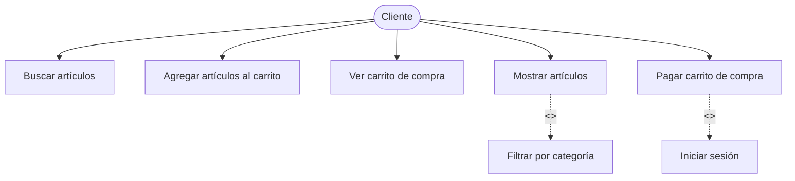
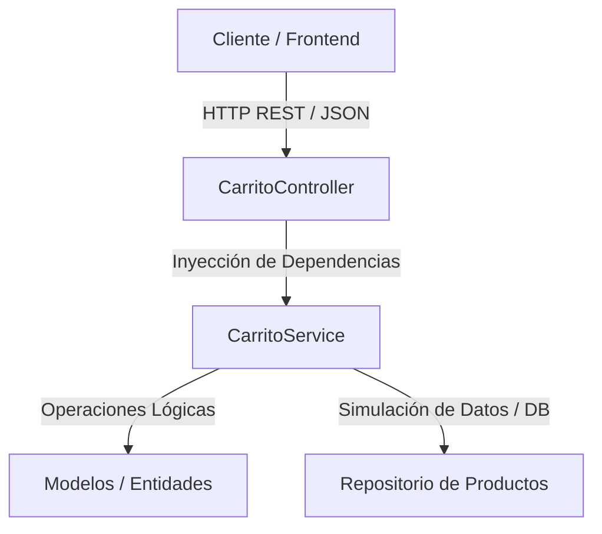
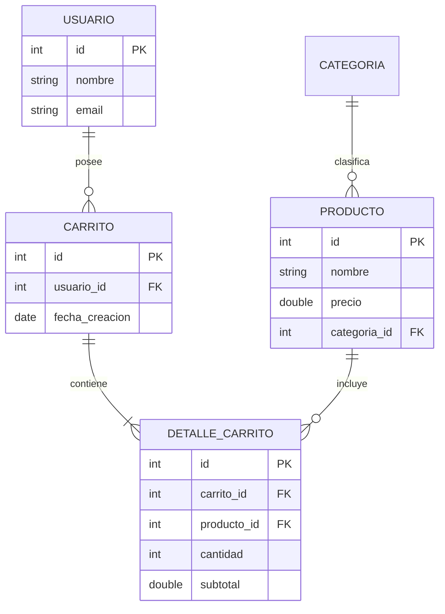
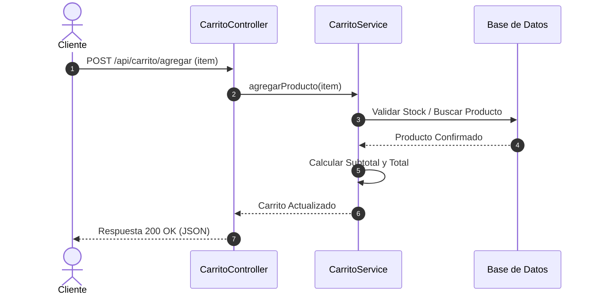

# Documentación Técnica - Proyecto CarritoGT (Migración a Spring Boot)

* **Curso:** Programación II
* **Universidad:** Universidad Mariano Gálvez de Guatemala
* **Estudiante:** Edison Alvarez
* **Versión del Documento:** 1.0

---

## 1. Evidencia de Virtualización y Recursos
* **Hipervisor Utilizado:** VirtualBox (Tipo 2)
* **Sistema Operativo Invitado:** Lubuntu (GNU/Linux)
* **Justificación de Recursos:** Se asignaron 2 GB de RAM y 2 núcleos de CPU para garantizar la estabilidad tanto en el sistema operativo Host (Windows) como en el invitado, permitiendo ejecutar Apache, MariaDB y los servicios de desarrollo simultáneamente sin bloqueos.

---

## 2. Diagrama de Casos de Uso
A continuación se representa el flujo de interacción del cliente con el sistema del carrito de compras:

## 3. Arquitectura del Sistema (Spring Boot)
Estructura en capas del microservicio backend en Java Spring Boot:

## 4. Diagrama Entidad-Relación (Base de Datos)
Estructura de las tablas y entidades del modelo de carrito de compras:

## 5. Diagrama de Secuencia (Agregar al Carrito)
Flujo de comunicación sincrónica al agregar un producto al carrito:

