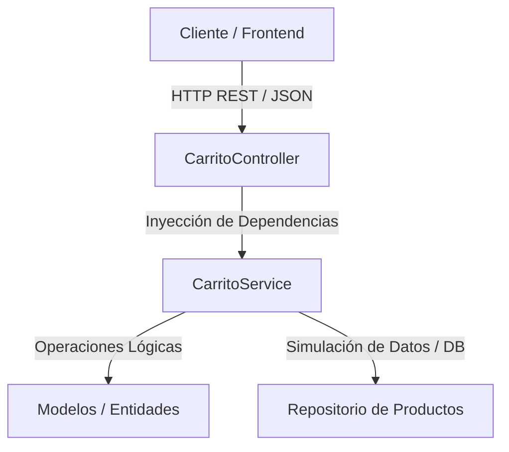
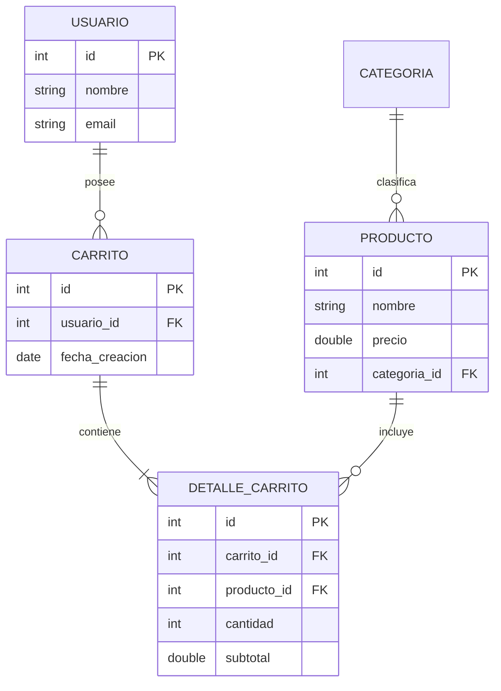
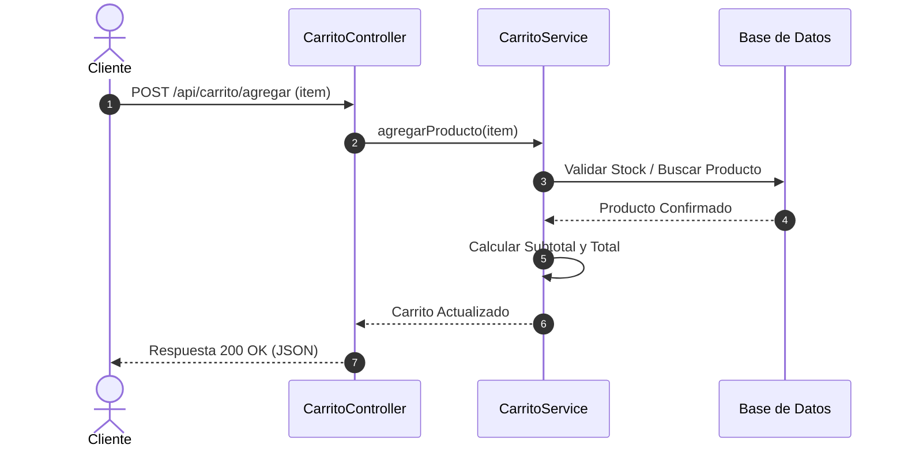

# Documentación Técnica - Proyecto CarritoGT (Migración a Spring Boot)

* **Curso:** Programación II
* **Universidad:** Universidad Mariano Gálvez de Guatemala
* **Estudiante:** Edison Alvarez
* **Versión del Documento:** 1.0

---

## 1. Evidencia de Virtualización y Recursos
* **Hipervisor Utilizado:** VirtualBox (Tipo 2)
* **Sistema Operativo Invitado:** Lubuntu (GNU/Linux)
* **Justificación de Recursos:** Se asignaron 2 GB de RAM y 2 núcleos de CPU para garantizar la estabilidad tanto en el sistema operativo Host (Windows) como en el invitado, permitiendo ejecutar Apache, MariaDB y los servicios de desarrollo simultáneamente sin bloqueos.

---

## 2. Diagrama de Casos de Uso
A continuación se representa el flujo de interacción del cliente con el sistema del carrito de compras:


## 3. Arquitectura del Sistema (Spring Boot)
Estructura en capas del microservicio backend en Java Spring Boot:



## 4. Diagrama Entidad-Relación (Base de Datos)
Estructura de las tablas y entidades del modelo de carrito de compras:



## 5. Diagrama de Secuencia (Agregar al Carrito)
Flujo de comunicación sincrónica al agregar un producto al carrito:




---

## 12. Bitácora de Desarrollo

A continuación se registra el historial de actividades, decisiones técnicas, dificultades superadas y commits relacionados desde septiembre hasta la fecha actual:

| Fecha | Avance realizado | Problema o decisión | Solución / aprendizaje | Commit relacionado |
| :--- | :--- | :--- | :--- | :--- |
| 02/09/2026 | Instalación y preparación del hipervisor en el sistema operativo Host. | Selección entre distribuciones Linux según disponibilidad de recursos de RAM/CPU. | Se eligió Lubuntu por su bajo consumo de recursos, asignando 2 GB de RAM y 2 núcleos. | `Configurar máquina virtual en VirtualBox` |
| 15/09/2026 | Instalación de servicios del servidor web y control de versiones. | Dificultad para gestionar paquetes y permisos en la máquina virtual. | Se instaló Git, Apache, PHP y MariaDB utilizando comandos en la terminal de Lubuntu. | `Instalar stack LAMP y configurar Git` |
| 28/09/2026 | Clonación del repositorio PHP y pruebas iniciales. | Configuración de credenciales y acceso a la base de datos MySQL/MariaDB. | Se importó el script de la base de datos con las 2 tablas y se ajustaron las credenciales en PHP. | `Clonar repositorio e importar base de datos` |
| 05/10/2026 | Configuración del Virtual Host en Apache. | Las imágenes y recursos estáticos daban error 404 al navegar fuera de `localhost`. | Se configuró el archivo Virtual Host y se ajustaron las rutas de los recursos estáticos. | `Configurar Virtual Host y rutas estaticas` |
| 08/10/2026 | Creación del proyecto en Java Spring Boot. | Definición del estilo arquitectónico y organización del proyecto backend. | Se implementó la arquitectura en capas (Controller, Service, Repository, Entity) bajo el patrón MVC. | `Inicializar proyecto Spring Boot con capas` |
| 11/10/2026 | Desarrollo de endpoints RESTful y persistencia de datos. | Manejo de peticiones HTTP, respuestas en formato JSON y consultas a la base de datos. | Se usó Spring Data JPA en la capa Repository para conectar con MariaDB y mapear las entidades. | `Implementar endpoints REST y persistencia JPA` |
| 14/10/2026 | Integración del Frontend y adaptación con JavaScript. | Sustitución de las plantillas PHP/Twig por consumo asíncrono desde el navegador. | Se utilizó JavaScript Vanilla (`fetch` API) para consultar los endpoints REST e interactuar con el carrito. | `Integrar frontend con fetch API y REST` |
| 16/10/2026 | Redacción de la documentación técnica y diagramas en Mermaid. | Errores de sintaxis y renderizado en GitHub al cerrar los bloques de código. | Se corrigió la sintaxis de Mermaid asegurando el cierre adecuado de bloques con tres acentos graves (```). | `Corregir cierres de diagramas con acentos graves` |
